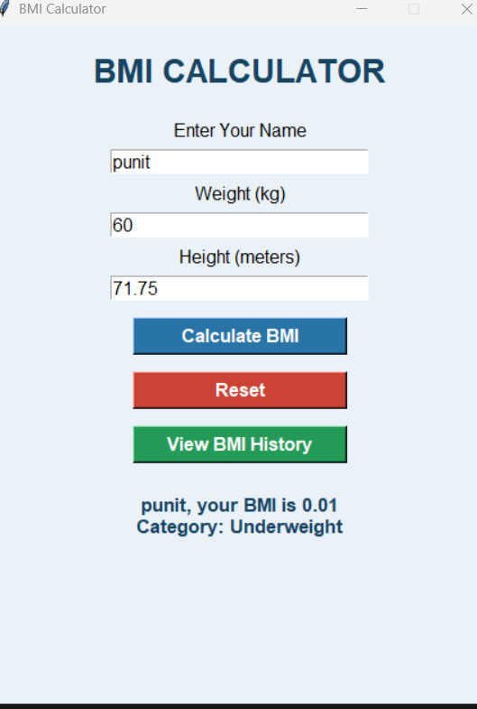

# BMI Calculator Using Python

A Python-based BMI (Body Mass Index) Calculator that calculates BMI based on a user's weight and height. This project includes a graphical user interface, SQLite database storage, BMI history tracking, and data visualization.

## Features

- Accepts the user's name.
- Takes weight in kilograms.
- Takes height in meters.
- Calculates BMI automatically.
- Displays BMI categories:
  - Underweight
  - Normal
  - Overweight
  - Obese
- Handles invalid inputs.
- Displays BMI up to two decimal places.
- User-friendly Tkinter GUI.
- Saves BMI records using SQLite.
- Displays previous BMI records in a history table.
- Visualizes BMI history using Matplotlib.
- Reset button to clear input fields.

## Technologies Used

- Python 3
- Tkinter
- SQLite3
- Matplotlib
- PyCharm
- Git
- GitHub

## Project Structure

```text
BMI_Calculator/
│
├── main.py
├── gui.py
├── database.py
├── visualization.py
├── README.md
├── .gitignore
└── screenshots/
    └── bmi_calculator.png
```

## Installation

1. Clone this repository:

```bash
git clone https://github.com/PunitPatil1029/BMI_Calculator.git
```

2. Open the project in PyCharm.

3. Install Matplotlib:

```bash
pip install matplotlib
```

## How to Run

**Run the GUI application:**

```bash
python gui.py
```

**View BMI visualization:**

```bash
python visualization.py
```

**Run the command-line version:**

```bash
python main.py
```

## BMI Formula

BMI = Weight (kg) / Height (m)²

## BMI Categories

| BMI Range | Category |
|---|---|
| Below 18.5 | Underweight |
| 18.5 – 24.9 | Normal |
| 25 – 29.9 | Overweight |
| 30 or above | Obese |

## Database

The project uses SQLite to store BMI records, including:

- User name
- Weight
- Height
- BMI value
- BMI category
- Date and time

## Screenshot

## Screenshot

## Screenshot



## Author

**Punit Patil**

GitHub: https://github.com/PunitPatil1029# BMI Calculator

## 📌 Project Description
The BMI Calculator is a Python-based application that calculates a person's Body Mass Index (BMI) using their weight and height. It helps users understand their BMI value and identify their corresponding BMI category.

This project was developed as part of the **OASIS INFOBYTE Python Programming Internship**.

## ✨ Features
- Calculate Body Mass Index (BMI).
- Accept weight and height as user inputs.
- Display the calculated BMI value.
- Classify BMI into health categories.
- Simple and beginner-friendly interface.

## 🛠️ Technologies Used
- Python 3
- Python fundamentals
- Conditional statements
- Mathematical operations

## 📥 Installation and Execution

### 1. Clone the repository
```bash
git clone https://github.com/PunitPatil1029/BMI_Calculator.git
```

### 2. Open the project folder
```bash
cd BMI_Calculator
```

### 3. Run the application
```bash
python main.py
```

## 📸 Screenshot


## 👨‍💻 Developer
**Punit Patil**

GitHub: https://github.com/PunitPatil1029

## 📄 License
This project is created for educational and internship purposes.